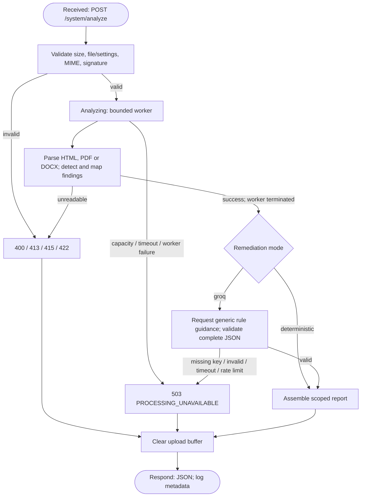
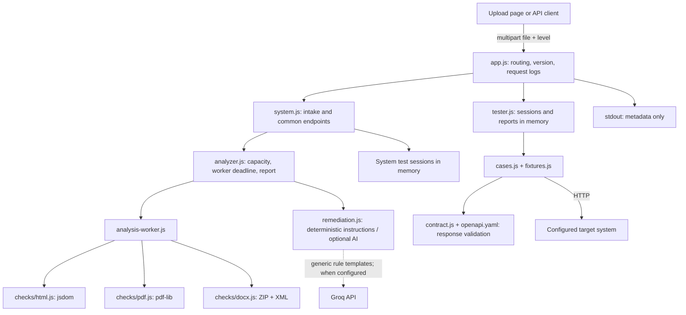

# Phase 4 system models

These models describe the **implemented local 0.4.0 source**, not a claim that Cloud Run already runs it. Groq is optional and has not been exercised with a real credential. The model source below and the rendered SVG/PDF artifacts describe the same components and flow.

## Model 1 — request workflow and states

Changed from Phase 3: the two-rule HTML-only step is replaced by bounded workers with format-specific parsers, deterministic checks and optional remediation. Parsing can produce a 422 even after a file passes signature checks. Resource limits and provider failures produce 503; all completion paths release upload memory.

Artifact: `models/workflow.svg` / `models/workflow.pdf`.

## Model 2 — component architecture and data flow

Changed from the Phase 2 sketch/Phase 3 model: a web upload page is the implemented client; parser/check modules and a Groq adapter now exist. No browser extension, standalone image/PPTX input or file-modification component is drawn as delivered. The tester and its in-memory state are shown because they are actual parts of this application.

Artifact: `models/architecture.svg` / `models/architecture.pdf`.

## Consistency check

| Element | Implementation evidence |
| --- | --- |
| Four intake checkpoints and all upload cleanup paths | `src/system.js`, T-04/T-06–T-11/T-24/T-25, O-03/O-04 |
| Per-format parser/check dispatch and worker teardown | `src/analysis-worker.js`, `src/analyzer.js`, T-18–T-30 |
| Fixed criteria and format-specific locations | `src/checks/*.js`, H-01–H-07/P-01–P-04/D-01–D-04 |
| Optional provider, strict response checks and failure path | `src/remediation.js`, G-01–G-06, T-16 |
| Common JSON schema conformance | `src/contract.js`, O-01/O-05 and all contract requests |
| Stateless documents / in-memory test state | `src/system.js`, `src/tester.js`, O-03/O-04; restart limitation disclosed |
| Web client reports, page locations and download | `public/index.html`, `public/app.js`, U-01/U-02 |

This is a source/test-based consistency check. An independent teammate walkthrough is still pending and must not be claimed as completed.
