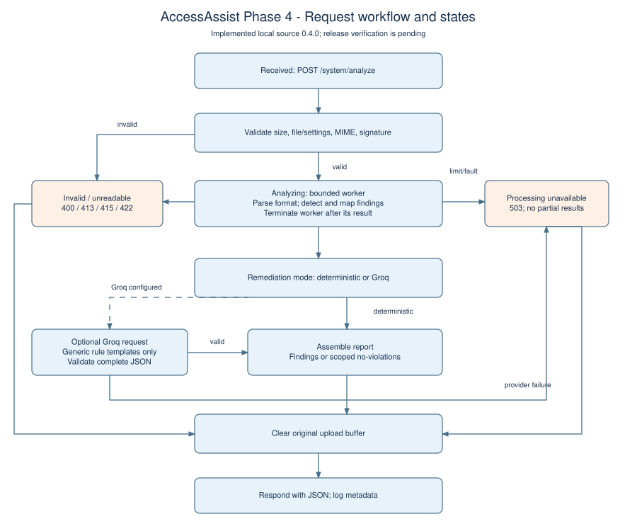
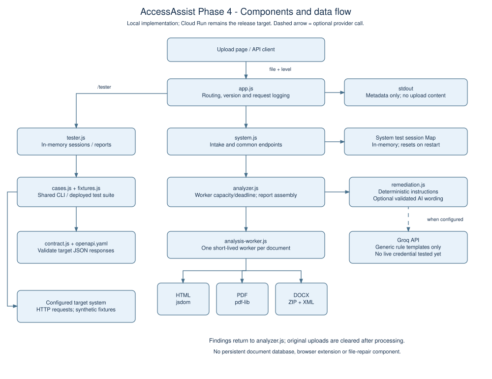

# ECE 30861 — Phase 4 Report

**Team 19 — AccessAssist — Pod F**  
**Prepared for: Xiyue Chen**  
**Preparation date: November 1, 2026 (Asia/Shanghai)**  
**Implementation: 0.4.0, publication branch `phase4`**  
**Base commit: `495707b827e97fcc8c7af8a426aadc4418372174`**  
**Phase 4 release commit/tag and deployed revision: PENDING**

This report covers Q1–Q5 and Q7–Q9. Q6 cross-team work is excluded as requested. The supplied Phase 2 PDF contains the team design/risk sections but not the complete shared requirements or milestone sections; the Phase 3 report and current OpenAPI file provide the available requirement mapping. This document distinguishes verified local implementation from the existing live Phase 3 service. **Before submission, complete the external actions and PENDING fields listed in `handoff.md`; do not present local results as deployed Phase 4 results.**

## Q1 Delivered Increment

### Q1.1 Increment description

Delivered capability: In the Phase 4 implementation, a course-material author can upload HTML, PDF or DOCX through the existing common interface and receive findings from actual format-specific checks. HTML now uses DOM analysis, including static solid-color contrast at Level AA, while PDF and DOCX checks inspect supported accessibility metadata and structure. Each finding identifies a WCAG criterion, a location when available, severity, an explanation and a concrete repair instruction; the browser displays PDF page locations and can export the JSON report. When the supported checks find no issues, every format receives an explicit scoped no-violations message that explains the remaining manual-review work. Deterministic remediation works without external credentials, and an optional Groq adapter has been implemented and tested with controlled provider responses but has not yet been exercised against the real provider. These capabilities are verified in the local 0.4.0 source; release to the existing Cloud Run service remains pending.

Users/stakeholders: Faculty and staff producing course materials, students who depend on accessible documents, and university accessibility staff. Regulatory provision(s): the web-content accessibility obligation in ADA Title II, 28 CFR §35.200(b), which references WCAG 2.1 Level AA [1, §35.200(b)] [2]. AccessAssist supports identifying and repairing selected issues; it does not certify full compliance.

The following statuses describe the implementation scope, not a claim that the new code is already deployed. REQ/AC numbering follows the supplied Phase 3 report and must be checked against the complete shared specification.

| Requirement worked on | Status | Demonstrated by / remaining work |
| --- | --- | --- |
| REQ-01 — File submission | Complete locally | AC-01: T-01, T-02, T-17 accept valid HTML, real PDF and DOCX samples |
| REQ-02 — Supported types and size limit | Complete locally | AC-02: T-03, T-04, T-10, T-11; inclusive limit of 10,485,760 bytes retained after upload-library update |
| REQ-03 — Unreadable-file rejection | Complete within supported formats | AC-03: T-06, T-07, T-24, T-25, P-04, D-04; real parsing rejects forged PDF and malformed Word XML |
| REQ-04 — Accessibility detection | Partial | AC-04: T-05, T-18–T-21, T-26–T-29, H/P/D tests. Bounded checks exist for all three formats; full agreed rule scope is not available for confirmation, and manual-review limits remain |
| REQ-05 — WCAG mapping | Complete for implemented checks | AC-05: exact criterion assertions in T-18–T-21/T-26–T-29 and H/P/D tests; mappings are deterministic |
| REQ-06 — Remediation guidance | Partial | AC-06: T-30 and G-01–G-06. Concrete deterministic instructions and optional provider integration exist; real Groq execution and human semantic-quality review remain pending |
| REQ-07 — Structured report | Complete locally | AC-07: T-05, T-20, T-30, O-05, U-01; schema-checked findings, PDF/Word locations and JSON export |
| REQ-08 — Explicit no-violations result | Complete for implemented checks | AC-08: T-15, T-22, T-23; all formats distinguish scoped checking from full compliance |
| REQ-09 — Processing/dependency failure | Complete in tested local scenarios | AC-09: T-16, G-03–G-05, O-04, O-06; missing credentials, malformed provider output, rate limits, timeout and processing limits produce failures without partial reports. Real provider/deployed faults remain unverified |
| REQ-10 — Temporary document handling | Partial | AC-10: O-03/O-04 verify original-buffer clearing; source review confirms in-memory parsing and worker termination. This is not a formal proof of every runtime memory or hosting-retention behavior |
| REQ-12 — Processing time | Partial | AC-12: T-11 passes the maximum-size synthetic HTML boundary locally. Dense documents, cold starts and production p95/load measurements remain for Phase 5 |
| REQ-13 — Consistent interface responses | Complete for tested documented paths locally | AC-13: all contract requests use JSON Schema checks; T-08/T-09/T-12/T-14 and O-01/O-02/O-05 cover response and error behavior |

REQ-11 HTTPS was regression-checked against the existing live host with T-13; the new version still needs deployment at that host before its release can claim deployed HTTPS verification.

### Q1.2 Comparison with the Phase 2 plan

The supplied Phase 2 PDF does not include Section 6, so the available milestone comparison uses the Phase 3 report's Q7.3, which explicitly assigns detection, mapping, remediation, structured reporting and no-violations responses (REQ-04–REQ-08) to Phase 4. The local implementation now provides that workflow across HTML, PDF and DOCX, with deterministic checks followed by optional AI wording as planned in Phase 2 Sections 7.2 and 8.2. Real Groq validation, agreed-scope confirmation and deployment of the new code remain incomplete; no instructor-approved scope reduction has been documented. For the rubric's literal comparison to the earlier Phase 3 milestone, the secure intake/API/testing foundation has been retained and regression-tested while real document analysis has been added.

## Q2 Deployment and Operation

### Q2.1 Deployed web service

The existing service is hosted on Google Cloud Run in `europe-west1` using the Node.js container described in the Phase 3 report; the system URL is `https://accessassist-git-365255122806.europe-west1.run.app/system` and the tester URL has the same host with `/tester`. A live probe on November 1, 2026 returned revision `accessassist-git-00008-f92`, so the new 0.4.0 code is not yet deployed and its release tag/SHA is **PENDING**. The previous service configuration scaled to zero when idle, which permits cold starts rather than an always-running instance; current billing/quota/settings must be confirmed, and graders should use single sequential test runs with files at or below 10 MiB until those limits are documented [3, minimum instances]. The proposed `cloudbuild.yaml` runs checks before building and deploying an image labeled with the supplied commit, while the updated live-check workflow verifies `/about.commit` before accepting test evidence; adopting this configuration and confirming the actual trigger remain release-owner tasks [4].

### Q2.2 Registry and team documentation

Registry entry: **Endpoint_Registry, Pod F / Team 19 row; exact sheet URL and Phase 4 update PENDING**. The row must identify both the deployed system and automated tester. The Phase 3 report's October 18 update is historical evidence and has not been reused as a Phase 4 update.

Team documentation: `README.md`, `docs/IMPLEMENTATION.md`, `docs/MODELS.md`, `docs/REMEDIATION_REVIEW.md` and this report, updated **2026-11-01** in the local working tree. The shared “ECE 30861 Pod F — Intra-Pod Specification” location and actual Phase 4 update date are **PENDING**. Deployment and shared-document/registry edits are listed in `handoff.md`.

### Q2.3 Operational experience supported by observability evidence

The Phase 2 design still uses a Node backend and temporary document processing, while the implemented client is a web upload page rather than the originally sketched browser extension. Uploads are held in memory, parsed in short-lived workers and cleared after success or failure; only test sessions/reports persist in process memory and reset on restart. Deterministic mode needs no secret; Groq mode requires a server-side `GROQ_API_KEY`, intended to be supplied from Secret Manager, and the adapter sends only generic rule templates rather than uploaded content [3, secrets] [5]. Request logs record timestamp, method, path, HTTP status, error code, latency and version identity; local logs are captured in `docs/evidence/local/requests.jsonl`, while the current deployed service was observed returning the following health/version signal. A **Phase 4 Cloud Logging excerpt, current service metrics/settings and actual provider operation are PENDING**, so the local log is not being presented as deployed evidence.

Observed deployed signal, 2026-11-01 05:56:15 Asia/Shanghai (2026-10-31 21:56:15 UTC), from `docs/evidence/phase3-live/results.json`:

```text
GET /system/health
HTTP 200
X-App-Version: accessassist-git-00008-f92
{"status":"ok"}
```

For the new release, attach one successful request and one expected failure from Cloud Logging, including the new commit/revision and latency, after deployment.

## Q3 Implementation and Interface Conformance

### Q3.1 Operation status

The table covers every operation in the repository's common OpenAPI contract. “Local” refers to tested 0.4.0 code; “live” refers to the observed Phase 3 revision. Runtime response validation uses the OpenAPI 3.1.1 schemas, plus semantic assertions for findings and explicit no-violations messages [6].

| Operation | Requirement(s) | Implemented | Success responses conform | Error responses conform |
| --- | --- | --- | --- | --- |
| GET /health | REQ-13 | Yes locally and on current live host | Yes: 200 status=ok | N/A: no error response specified |
| GET /formats | REQ-02, REQ-13 | Yes locally and on current live host | Yes: MIME list and size limit | N/A: no error response specified |
| POST /analyze | REQ-01–REQ-10, REQ-12, REQ-13 | Local: yes within documented bounded scope; live: partial | Local: yes for tested schemas and implemented semantics. Live: schemas pass, but Phase 4 semantic tests fail because the old release does not perform the new checks | Local: documented 400/413/415/422/503 paths conform. Live: malformed DOCX and forged PDF incorrectly return 200 under the new parser tests; new provider failures are unverified |
| POST /test/setup | Course test interface | Yes locally and on current live host | Yes: 201 with session_id | Yes for tested 400/409 paths |
| GET /test/report | Course test interface | Partial: report endpoint exists; live per-session line coverage is not enabled | Yes to the repository schema; coverage.code has null counts and an explicit reason | Yes for tested 400/404 paths |

Integration: `app.js` routes and logs requests; `system.js` validates the upload and invokes `analyzer.js`, which starts a bounded worker selecting HTML, PDF or DOCX checks and then optionally calls `remediation.js`. HTML analysis uses jsdom without script/resource execution [7], and PDF analysis uses pdf-lib to inspect document objects [8]; DOCX is read as an in-memory ZIP/XML package. Fixed rule mappings and validated guidance are assembled into the existing response shape, rendered by the web page and exercised by the shared tester cases.

### Q3.2 Contract changes and pod communication

Contract version at delivery: **repository OpenAPI 0.3.0, unchanged; implementation package 0.4.0**. Changes since Phase 2: no new common endpoint or response-schema change was made in this work; the course test endpoints and optional result fields already existed in Phase 3. Pod agreement: **PENDING verification of the current shared specification and any post-Phase-3 decisions**; no agreement date/channel is invented. Intentional deviations and resolution plan: live per-session coverage remains null, the rule scope is bounded, and the original optional fields/location/severity decisions need confirmation against the shared contract; the team must resolve these with the pod rather than silently reduce shared scope.

The tester endpoints remain documented by the existing course interface and README, not by the system-only `openapi.yaml`; official tester-spec conformance beyond the repository tests needs the actual course specification.

## Q4 Automated Validation

### Q4.1 Test runner and execution instructions

Base URL override: `BASE_URL=<team-system-base-url> npm run test:remote`, or pass `{"target_url":"<team-system-base-url>"}` to the deployed tester's setup endpoint, then run with the returned session ID. For timestamped/versioned evidence, use `BASE_URL=<url> EXPECTED_SHA=<released-sha> npm run evidence`; no test-code changes are needed. Response received from the currently deployed host: **200 `{"status":"ok"}`**, with version `accessassist-git-00008-f92`. Conforms to spec: **health response yes; new Phase 4 behavior is verified locally, but deployed Phase 4 conformance remains PENDING**.

Known deviations/limitations: the current live version fails 11 of the expanded semantic tests; per-session code coverage is null; the tester interface is not in the system OpenAPI; shared acceptance of the existing optional result fields and bounded rule scope has not been verified. Local schema checks do not establish agreement with a shared specification that was not supplied.

### Q4.2 Tests for new functionality

All IDs below are executable names in `src/cases.js` or `test/*.test.js`. The REQ/AC mapping follows the Phase 3 report and is subject to checking against the full pod document.

| AC | Requirement(s) | Tests | Type | Automated |
| --- | --- | --- | --- | --- |
| AC-01 | REQ-01 | T-01, T-02, T-17: HTML/PDF/DOCX accepted | Success | Yes |
| AC-02 | REQ-02 | T-03/T-04; T-10/T-11: supported types and inclusive size boundary | Success, failure, boundary | Yes |
| AC-03 | REQ-03 | T-06/T-07/T-24/T-25, P-04, D-04: empty/truncated/forged/corrupt inputs | Failure | Yes |
| AC-04 | REQ-04 | T-05/T-18–T-21/T-26–T-29; H-01–H-07, P-01–P-03, D-01–D-03 | Success, failure, boundary | Yes for the implemented rule subset |
| AC-05 | REQ-05 | T-18–T-21/T-26–T-29; exact H/P/D mapping assertions; G-02 preserves mapping | Success, boundary | Yes |
| AC-06 | REQ-06 | T-30, G-01–G-06; human rubric in docs/REMEDIATION_REVIEW.md | Success, failure | Automated structure/provider-failure checks; semantic-quality review PENDING |
| AC-07 | REQ-07 | T-05/T-20/T-30, O-05, U-01/U-02: schema, locations, displayed report and error state | Success, failure | Yes |
| AC-08 | REQ-08 | T-15/T-22/T-23: explicit scoped clean HTML/PDF/DOCX responses | Success | Yes |
| AC-09 | REQ-09 | T-16, G-03–G-05, O-04/O-06: dependency/internal failures, timeout and finding budget | Failure, boundary | Yes locally; real provider and deployed fault tests PENDING |
| AC-10 | REQ-10 | O-03/O-04: buffer clearing after success/failure and no document data in request logs | Success, failure | Yes for tested paths; broader privacy verification incomplete |
| AC-11 | REQ-11 | T-13: HTTP refused or redirected to HTTPS | Failure/security regression | Yes on existing live host; skipped on local HTTP |
| AC-12 | REQ-12 | T-11: maximum-size HTML within 30 seconds | Boundary | Yes locally; representative deployed p95/load validation PENDING |
| AC-13 | REQ-13 | T-08/T-09/T-12/T-14, O-01/O-02/O-05; runtime schema checks on all contract calls | Success, failure | Yes |

Oracles: Error statuses and field shapes are taken from the checked-in contract, while known defects are planted in independent fixture construction rather than inferred from analyzer output. Contrast tests use analytically known black/white and identical-color ratios plus cases on both sides of the 4.5 threshold; PDF and DOCX fixtures contain real page/tag or ZIP/XML structures with specific alternate-text and language fields. Groq tests use controlled success/failure responses to check protocol behavior and preservation of deterministic findings, and the report explicitly reserves semantic correctness for human review rather than treating non-empty text as proof of a good repair.

### Q4.3 Regression and static checks

CI run: **PENDING — no CI execution for this new branch has been claimed**. Local evidence is saved under `docs/evidence/verification/` and `docs/evidence/local/`.

The final local full-suite run on November 1, 2026 contained **66 tests: 65 passed, 0 failed and 1 skipped** (T-13 requires HTTPS and is skipped on the local HTTP server). Aggregate backend coverage across `src/**/*.js` was **96.11% lines/statements (1,090/1,134), 82.17% branches (415/505) and 97.75% functions (87/89)**. This is local suite coverage, not coverage from a deployed test session; the complete output and LCOV data are retained in `docs/evidence/verification/`. The separate local evidence run exercises the 30 common cases and eight protocol probes.

The prior contract cases T-01–T-16 are retained, with the old synthetic PDF stub replaced by an actual PDF so parser validation has a trustworthy input. Every pull request and push to main is configured to run lint, OpenAPI validation, the production dependency audit and the full backend/UI test suite with backend coverage [4]. New cases are shared by CLI and deployed tester, and the live workflow now checks the served commit before accepting evidence so an older revision cannot silently stand in for the release. Remote repository settings and successful CI execution remain to be verified by the release owner.

### Q4.4 Static checks

CI run: **PENDING for the Phase 4 commit**. Locally, ESLint passed with zero warnings, Redocly validated `openapi.yaml` with one existing advisory for the intentional localhost development server, and `npm audit --audit-level=high --omit=dev` reported zero production vulnerabilities; the project has no static type checker. These checks run in the pull-request/main CI configuration and in the proposed Cloud Build pipeline before deployment, but a failing check can only be claimed to block merge/deployment after branch protection and adoption of that pipeline are confirmed. The production dependency update fixes the vulnerable upload/body-parser dependencies; moderate findings remain in development tooling and are disclosed in `handoff.md`.

### Q4.5 Test results against the deployed system

**The 0.4.0 implementation is not deployed yet.** The following is the actual expanded-suite run against the existing Phase 3 service, retained as baseline evidence rather than relabeled as a Phase 4 success.

Run date/time: **2026-11-01 05:56:15 Asia/Shanghai** (2026-10-31 21:56:15 UTC). Version tested: **Cloud Run revision `accessassist-git-00008-f92`**, mapped to commit `495707b827e97fcc8c7af8a426aadc4418372174` by the supplied Phase 3 report; current build metadata was not independently fetched. Tests listed: **30**; executed: **29**; passed: **18**; failed: **11**; skipped: **1**; execution errors: **0**. Evidence: `docs/evidence/phase3-live/results.json` and `summary.md`.

| Failure | Classification | Cause | Plan |
| --- | --- | --- | --- |
| T-18 | System | Live HTML analyzer lacks AA contrast detection | Deploy validated Phase 4 HTML checks; rerun in Phase 4 |
| T-20 | System | Live PDF handling produces no Figure finding/page location | Deploy PDF parser/checks; rerun in Phase 4 |
| T-21 | System | Live DOCX handling produces no picture-alt finding | Deploy DOCX parser/checks; rerun in Phase 4 |
| T-22 | System | Live clean PDF response says no evaluation performed | Deploy actual PDF checking and scoped clean result in Phase 4 |
| T-23 | System | Live clean DOCX response says no evaluation performed | Deploy actual DOCX checking and scoped clean result in Phase 4 |
| T-24 | System | Live signature-only validation accepts malformed Word XML | Deploy real ZIP/XML validation in Phase 4 |
| T-25 | System | Live signature-only validation accepts a forged PDF | Deploy real PDF parsing in Phase 4 |
| T-27 | System | Live HTML rule treats an unnamed functional image with empty alt as acceptable | Deploy DOM-based functional-image check in Phase 4 |
| T-28 | System | Live analyzer has no label/name checks | Deploy form/button checks in Phase 4 |
| T-29 | System | Live analyzer has no PDF structure/title/language checks | Deploy PDF metadata/structure checks in Phase 4 |
| T-30 | System | Live PDF/DOCX returns no located findings or repair instructions | Deploy structured report generation for both formats in Phase 4 |

T-16 was skipped because public targets must not be given process-level fault injection; it is tested locally. All these classifications are relative to the implemented Phase 4 test expectations and must be reconciled with the complete shared AC text. The local test/evidence files show the new code passing the corresponding checks, but the required final deployed run and release SHA remain **PENDING**; replace this subsection with that run after release and retain this baseline separately.

## Q5 Updated System Models

### Q5.1 Model updates

Request workflow/state model — flowchart. Changed: **yes**. The former two-rule HTML evaluation step is replaced by bounded format-specific parsing/checking, deterministic mapping, optional validated provider guidance and explicit worker/upload cleanup paths. The model distinguishes unreadable documents (422) from processing/provider failure (503). Location: `docs/MODELS.md`, rendered artifact `docs/models/workflow.svg` / `workflow.pdf`, Figure 1 below.



System architecture — component/data-flow diagram. Changed: **yes**. The actual web page, Express routes, worker, HTML/PDF/DOCX modules, remediation adapter, tester, runtime contract validator and in-memory session state are shown. Groq is marked optional, and neither a browser extension nor a file-repair component is shown as delivered. Location: `docs/MODELS.md`, rendered artifact `docs/models/architecture.svg` / `architecture.pdf`, Figure 2 below.



Both diagrams describe the local implementation and configuration, with deployment status stated explicitly; they do not claim the existing live revision already contains these components.

### Q5.2 Model-implementation consistency

Each diagram element was traced to the corresponding source module, and the mapping table in `docs/MODELS.md` links its behavior to contract/parser/provider/UI tests. The request model was checked against the execution order in `system.js`, including parsing failures after signature checks and clearing buffers on success and error. One concrete divergence from Phase 2 was corrected in the model: the original sketch included a browser extension and possible file modification, but the implemented client is the web upload page and the system returns guidance rather than modified files. The Groq adapter now appears as a configurable component because its code exists, but its external call remains explicitly unverified; an independent teammate walkthrough is still pending.

## Q7 Status, Limitations and Next Phase Adjustments

### Q7.1 What changed and what remains incomplete

Changed since Phase 2:

- A common upload/API/tester implementation and web page exist, with type/size/error handling and JSON contracts (REQ-01–REQ-03, REQ-11, REQ-13; AC-01–AC-03, AC-11, AC-13).
- Deterministic HTML checking now includes static AA contrast, labels/names and document metadata; PDF and DOCX have actual parsing and bounded accessibility checks (REQ-04/REQ-05; AC-04/AC-05).
- Located findings, repair instructions, scoped clean responses and JSON export work for all three supported formats in local validation (REQ-06–REQ-08; AC-06–AC-08).
- Optional provider integration validates complete responses and preserves fixed mappings, while failures/resource limits return 503 without partial results (REQ-05/REQ-09; AC-05/AC-09).
- Tests now cover real document fixtures, parser corruption, privacy-relevant cleanup/logging, UI rendering and schema conformance, with timestamped evidence collection (REQ-03/REQ-10/REQ-12/REQ-13; AC-03/AC-10/AC-12/AC-13).

Remaining incomplete:

- Deploying 0.4.0 and rerunning validation at the final commit, with updated registry/shared documentation and new operational evidence (all delivered REQs/ACs, particularly REQ-11/REQ-13).
- Confirming the shared bounded rule scope and any agreed optional fields/location/severity definitions against the complete pod specification (REQ-04–REQ-08/REQ-13; AC-04–AC-08/AC-13).
- Real Groq execution and human review of remediation quality; runtime AI is not yet demonstrated (REQ-06/REQ-09; AC-06/AC-09).
- Representative deployed performance, cold-start/load measurements and broader retention/failure investigations (REQ-09/REQ-10/REQ-12; AC-09/AC-10/AC-12).
- Durable test sessions and live per-session coverage, if the course interface requires them; current report shapes disclose the limitations (course test interface).

### Q7.2 Known limitations and defects

| ID | Limitation / affected requirement or operation | Severity | Workaround | Target |
| --- | --- | --- | --- | --- |
| LIM-01 | Live host still runs Phase 3; new analysis is local only. Affects REQ-04–REQ-08, POST /analyze | High | Use the local 0.4.0 branch for review; release owner must deploy before grading | Phase 4 |
| LIM-02 | Bounded checks and incomplete shared-scope confirmation. No OCR, full WCAG/PDF-UA validation or PDF/DOCX visual contrast. Affects REQ-04/REQ-05/REQ-08 | High | Inspect checks_run/message and perform manual accessibility review; confirm pod scope | Phase 4 scope agreement; Phase 5 refinement |
| LIM-03 | Groq only tested with controlled responses; semantic guidance review pending. Affects REQ-06/REQ-09 | Medium | Deterministic mode provides actionable guidance; disclose AI incompleteness if AI is required | Phase 4 |
| LIM-04 | Sessions/reports are in-memory and can be lost on restart or split across instances. Affects test/setup and test/report | Medium | Run setup/run/report promptly; recreate lost sessions; review single-instance configuration | Phase 5 |
| LIM-05 | Live per-session code coverage is null. Affects GET /test/report | Medium | Use clearly labeled aggregate CI coverage; do not claim it is session coverage | Phase 5, subject to course requirements |
| LIM-06 | Resource limits may reject complex files below 10 MiB; production latency/memory not profiled. Affects REQ-02/REQ-12, POST /analyze | Medium | Use supported bounded documents and sequential requests; retry 503; measure realistic load | Phase 5 |
| LIM-07 | Public tester has no private-target/redirect restriction or rate control. Affects tester/test/setup and tester/test/run | High | Restrict access/egress and runtime privileges before hardened public use | Phase 5 |
| LIM-08 | Strict OOXML, encrypted documents, legacy VML/header-footer pictures and some CSS/name semantics are unsupported or require manual review. Affects REQ-03/REQ-04 | Medium | Use unencrypted Transitional DOCX/normal PDF/UTF-8 HTML and review unsupported content separately | Phase 5 |

Development-tool audit advisories and the intentional OpenAPI localhost warning are also documented in `handoff.md`; neither is represented as a clean full-development-dependency audit.

### Q7.3 Adjustments to next phase milestone

The Phase 4 milestone recorded in the Phase 3 report still describes the intended capability: detection, fixed WCAG mapping, remediation, structured reporting and explicit no-violations results. The code now implements that workflow locally, while deployment, scope confirmation and real-provider/human verification remain Phase 4 completion tasks rather than being silently moved out of scope. For Phase 5, the priority is representative Cloud Run latency/memory/fault testing, broader privacy verification and reliable test-session operation; adding asynchronous endpoints or reducing common scope would require pod agreement and any instructor sign-off required by the rubric. Risk 1 from Phase 2 is reduced because AI cannot change detector mappings and the adapter rejects incomplete responses, but real semantic quality/provider reliability remain open; Risk 2 is only partly reduced by the synthetic 10 MiB test, with dense-document performance, cold starts, in-memory sessions, public tester exposure and deployed/local version drift remaining priorities.

## Q8 GenAI Use in This Phase

### Q8.1 Actual GenAI use

Compared with Phase 2 Section 8.2, GenAI was used for engineering implementation, tests, model preparation and report drafting. The runtime Groq integration was written, but no real Groq request was made in this session, so engineering use and runtime AI validation are distinct.

**Xiyue Chen — draft for personal review**

Tools and delegation: I used ChatGPT/Codex with the repository, Phase 2 PDF, Phase 3 draft report and Phase 4 rubric as context. I delegated implementation of the new analysis workflow, automated tests, system models, documentation and draft report answers. I instructed the assistant to collect unknown requirements, account access and evidence gaps in `handoff.md` rather than invent answers.

Verification: Codex ran the local contract/unit/integration/UI tests, runtime schema validation, lint, production dependency audit and an expanded suite against the existing live service, saving the outputs for inspection. The report distinguishes those recorded results from a successful Phase 4 deployment, which has not happened. My own final code/report review and any teammate review remain to be recorded before merge or submission; this draft does not claim those reviews already occurred.

Correction example: The first implementation retained Phase 3's upload-library boundary assumption after upgrading the library, allowing a file one byte over the limit to reach analysis. T-10 exposed the defect, and an explicit file-size comparison was added so the boundary no longer depends on library inclusivity. T-11 also exposed an insufficient worker memory budget for the maximum-size fixture; the budget was adjusted and the boundary tests rerun successfully.

Agentic principles: I supplied the actual source documents and asked for evidence-backed implementation and answers. Tests and saved outputs were used to check generated work, and uncertainty about shared scope, deployment, provider use and personal experience was kept visible. A limitation is that a substantial amount of code and writing was delegated in one session, and human/teammate review still needs to be completed before release; I should not treat passing generated tests alone as proof of full accessibility compliance.

**Other teammates: PENDING actual Phase 4 records.** Remley, Prisha and Athena must each provide their own tools/delegation, verification, real correction example and reflection. Their Phase 3 stories have not been copied or reattributed as Phase 4 experience.

## Q9 References

[1] U.S. Department of Justice / Electronic Code of Federal Regulations. “28 CFR §35.200 — Requirements for web and mobile accessibility.” https://www.ecfr.gov/current/title-28/chapter-I/part-35/subpart-H/section-35.200. Accessed: 2026-11-01.

[2] World Wide Web Consortium (W3C). “Web Content Accessibility Guidelines (WCAG) 2.1.” W3C Recommendation; current published text, May 6, 2025, with the original 2018 version identified by the regulation. https://www.w3.org/TR/WCAG21/. Accessed: 2026-11-01.

[3] Google Cloud. “Cloud Run documentation: Set minimum instances for services; Configure secrets for services.” https://cloud.google.com/run/docs/configuring/min-instances and https://cloud.google.com/run/docs/configuring/services/secrets. Accessed: 2026-11-01.

[4] GitHub. “Understanding GitHub Actions.” https://docs.github.com/en/actions/get-started/understand-github-actions. Accessed: 2026-11-01.

[5] Groq. “Structured Outputs — JSON Object Mode.” https://console.groq.com/docs/structured-outputs. Accessed: 2026-11-01.

[6] OpenAPI Initiative. “OpenAPI Specification v3.1.1.” October 24, 2024. https://spec.openapis.org/oas/v3.1.1.html. Accessed: 2026-11-01.

[7] jsdom contributors. “jsdom: A JavaScript implementation of web standards for Node.js.” Project documentation; implementation uses the version locked in package-lock.json. https://github.com/jsdom/jsdom. Accessed: 2026-11-01.

[8] PDF-LIB contributors. “PDFDocument API.” pdf-lib 1.17.1 documentation. https://pdf-lib.js.org/docs/api/classes/pdfdocument. Accessed: 2026-11-01.

Evidence artifacts and supplied course documents are identified at the relevant answers. No cross-team result, pod decision, CI execution, account update or human review is asserted without supporting evidence.
